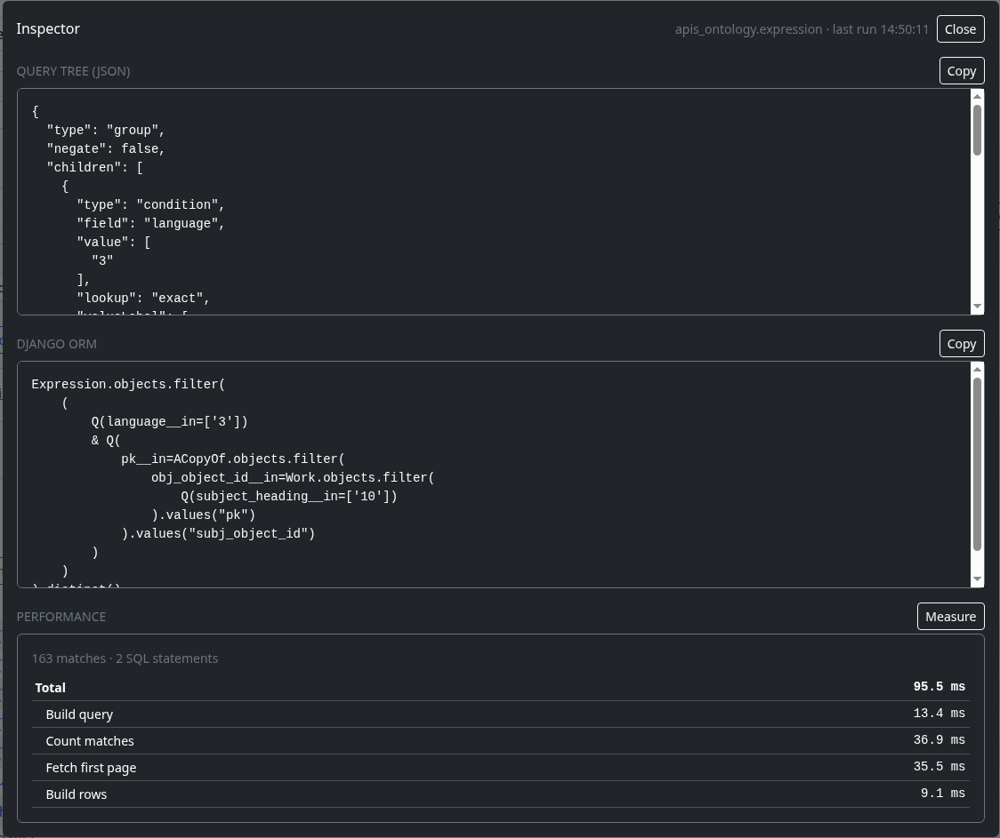

# Inspect query

!!! warning "Beta"

    The inspector is intended for developers and may change before the feature is final.

The inspector shows the query in three forms, and measures how long it takes to run.

## Open the inspector

Click **Inspect**, at the right of the results header. The button is shown when the inspector is enabled. See [Settings](../developers/settings.md).

<figure markdown="span">
  
  <figcaption>The inspector, with the query tree, the Django ORM code and the performance timings</figcaption>
</figure>

## Query tree (JSON)

The query as the package stores it. This is the same structure that saved queries and the API use. Use **Copy** to copy it.

## Django ORM

The equivalent Django ORM code for the current query. Use it to check what the query does, or to reuse it in a script. Use **Copy** to copy it.

## Performance

Click **Measure** to time the first page of results on the server. The measurement uses the same sort and columns as the last search.

Measurement runs only when you click **Measure**. Results are not timed automatically.

## Related

- [Relation search](../search/relation-search.md)
- [Settings](../developers/settings.md)
