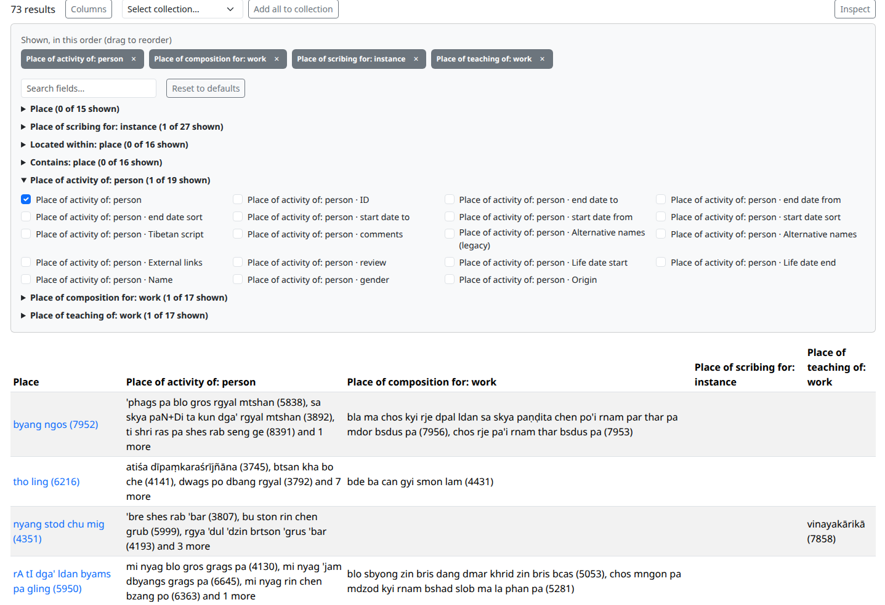

# Columns

The results table shows a set of columns. Each model has a default set, which you can change for a single search.

## Default columns

Set the defaults per model in `APIS_ADVANCED_SEARCH_COLUMNS`. See [Settings](../developers/settings.md).

```python
APIS_ADVANCED_SEARCH_COLUMNS = {
    "sample_project.person": [
        "date_of_birth",
        "sample_project.personlivedinplace:obj.label",
    ],
}
```

## Change the columns

1. Click **Columns** above the results.
2. Tick the columns to show. Columns are grouped by source, and each group shows how many of its columns are shown.
3. Drag the shown columns to reorder them.
4. Click **Reset to defaults** to return to the configured set.


<figure markdown="span">
  
  <figcaption>Columns selector for Place</figcaption>
</figure>

## Relation columns

Relation columns are named after the relation and the side of the related object:

| Name | Shows |
| --- | --- |
| `app.relation:obj` | The related object on the object side |
| `app.relation:subj` | The related object on the subject side |
| `app.relation:obj.latitude` | A field of the related object |

Foreign key and many-to-many fields of the related entity are also available as columns.

## Related

- [Simple search](simple-search.md)
- [Settings](../developers/settings.md)
