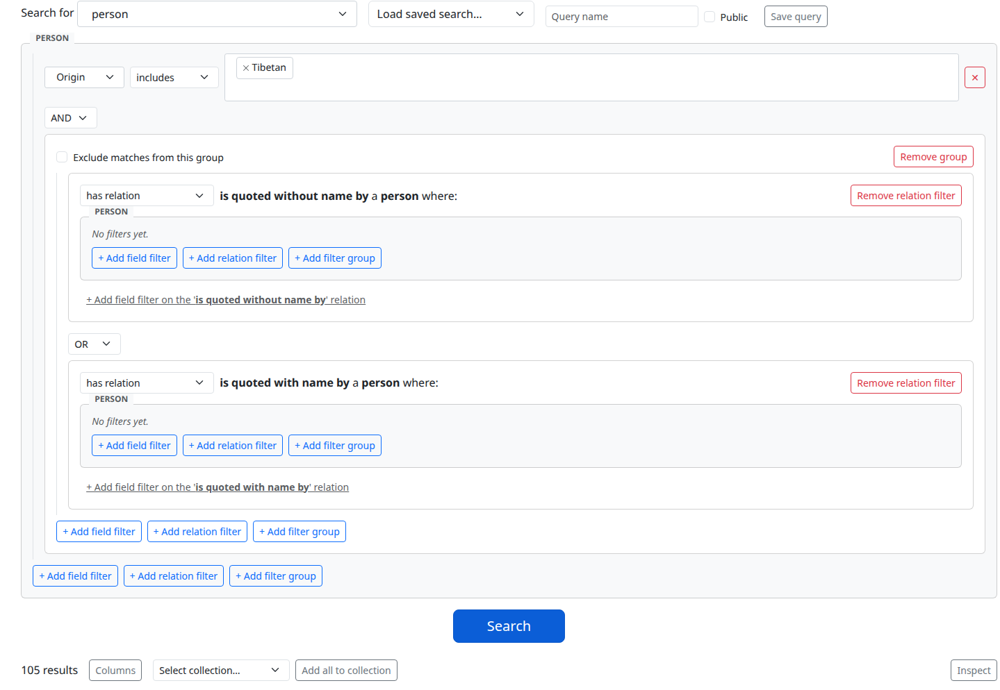

# Groups

A group combines a set of filters and relation filters. Groups can be nested.

## Add a group

Click **+ Add filter group**. A new group is empty and shows a hint until a filter is added to it.

## Connect the children

Each group joins its children with **AND** or **OR**. The connector is shown between each pair of children.

## Exclude a group

Tick **Exclude matches from this group** to negate the group. Records that match the group are removed. This is a NOT condition.

## Remove a group

Click **Remove group**. Its filters are removed with it.

## Example

Find Tibetan scholars who are quoted by a person, with or without a name.

**Building the query**

1. Search for **Person**.
2. Add a field filter: **Origin** is **Tibetan**.
3. Add a filter group and set its connector to **OR**.
4. In the group, add a relation filter: **has relation**, quoted without name by a person.
5. In the same group, add a second relation filter: **has relation**, quoted with name by a person.

The top-level connector stays **AND**, so the origin filter and the group must both match.

<figure markdown="span">
  
  <figcaption>Tibetan scholars who are quoted with or without name</figcaption>
</figure>

## Related

- [Simple search](simple-search.md)
- [Relation search](relation-search.md)
