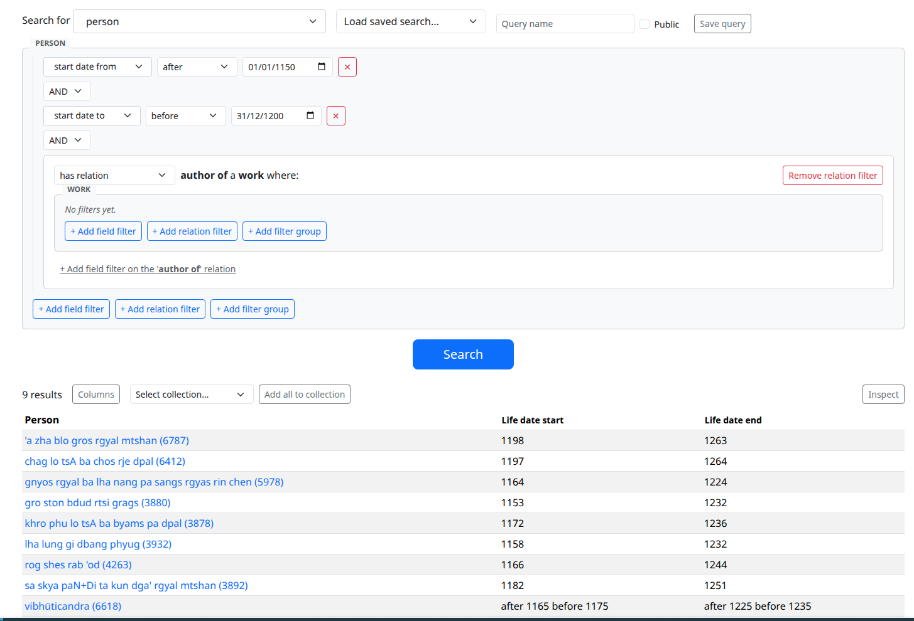
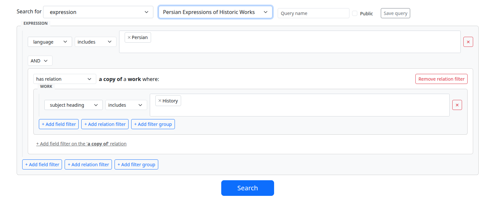
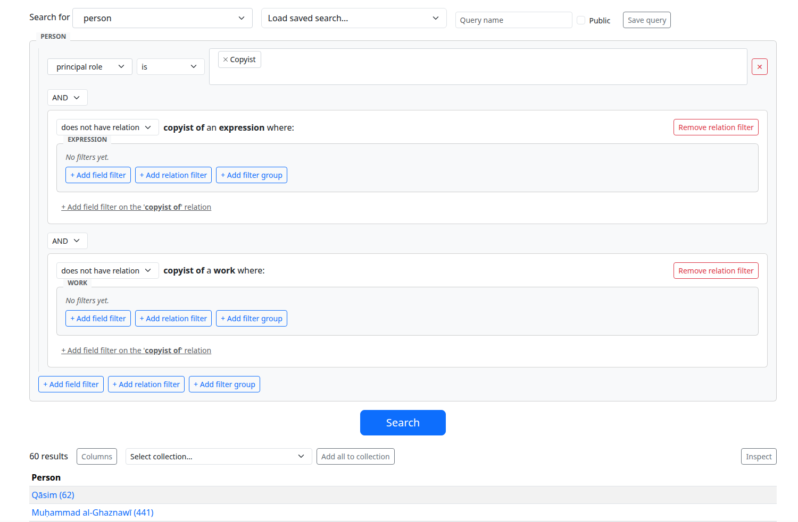

# Relation search

Relation search filters an entity by the relations it takes part in. It can also filter the entity on the other side of the relation.

Relation filters are available on entity models and relation models.

## Add a relation filter

1. Click **+ Add relation filter**.
2. Choose a relation from the list. Each option shows the relation and the direction.
3. Add conditions to the relation, the related entity, or both.

<figure markdown="span">
  
  <figcaption>Authors (Persons who have at least one "author of" relation), who were born between 1150 and 1200</figcaption>
</figure>

## Filter the relation itself

Under **And the relation itself**, add field filters on the relation model's fields.

## Filter the related entity

The related entity block filters the subject or object entity. It accepts the fields and relations of that entity, so relation filters can be nested.

## Has or does not have the relation

The first select in the relation filter sets the condition:

- **has relation**: matches records that have the relation, with the conditions below.
- **does not have relation**: matches records that do not have a relation that meets those conditions.

When set to **does not have relation**, the own-relation block reads **No relation where the relation itself matches**.

## Examples

### Persian expressions of historic works

Find Expressions that:

- have Persian as a language, and
- are a copy of a Work (through the `ACopyOf` relation) that has History as a subject heading.

Build it as:

1. Search for **Expression**.
2. Add a field filter: **Language** is **Persian**.
3. Add a relation filter: **ACopyOf**. Choose the option whose related side is the Work.
4. In the related entity block, add a relation filter on the Work's **Subject heading**, with the value **History**.

<figure markdown="span">
  
  <figcaption>Persian expressions of historic works</figcaption>
</figure>

The query runs as a single Django ORM query. The [Inspect query](../beta/inspect-query.md) panel shows it.

### Copyists who are not attributed as copyist to any work or expression

Find Copyists who are not attributed as the copyist for any work or expression.

<figure markdown="span">
  
  <figcaption>Copyists who are not attributed as the copyist for any work or expression</figcaption>
</figure>

## Related

- [Groups](groups.md)
- [Columns](columns.md), including relation columns
