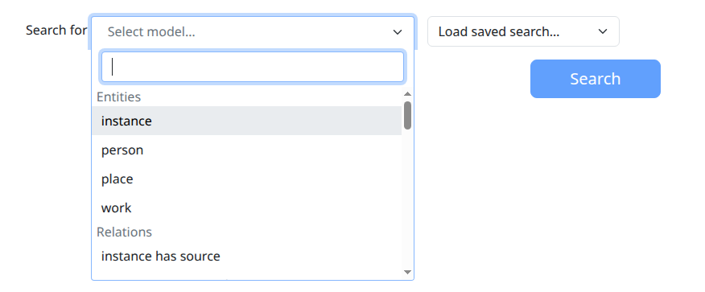
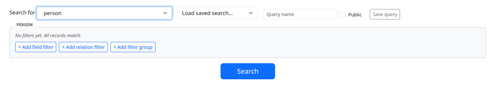
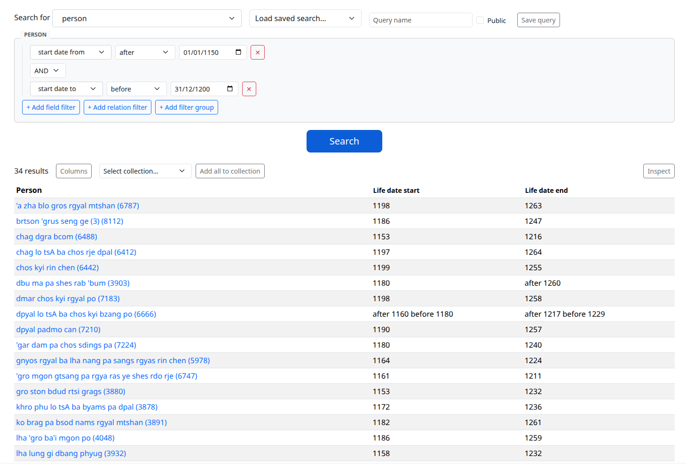

# Simple search

Simple search filters the fields of a single model.

## Choose a model

Select the model in **Search for**. Any registered entity or relation model can be the starting point.

<figure markdown="span">
  
  <figcaption>Model selector</figcaption>
</figure>

## Add a field filter

<figure markdown="span">
  
  <figcaption>Empty query builder for filtering persons</figcaption>
</figure>

1. Click **+ Add field filter**.
2. Choose a field.
3. Choose an operator.
4. Enter a value, if the operator needs one.

### Operators

| Field type | Operators |
| --- | --- |
| Text | contains, does not contain, is, is not, starts with, does not start with, ends with, does not end with |
| Number | is, is not, `>`, `>=`, `<`, `<=` |
| Date | on, not on, after, on or after, before, on or before |
| Any | is empty, is not empty |

Text matches ignore case.

## Filter empty values

Use **is empty** or **is not empty** to find records where a field has no value, or has one. These operators take no value.

## Combine filters

Filters added at the top level are combined with AND by default. To use OR, or to exclude a set of filters, use [groups](groups.md).

## Run the search

Click **Search**. Results appear below the builder, 25 per page. Use **‹ Prev** and **Next ›** to move between pages.

<figure markdown="span">
  
  <figcaption>Persons born between 1150 and 1200</figcaption>
</figure>

## Related

- [Relation search](relation-search.md)
- [Columns](columns.md)
